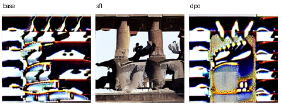

# Diffusion preference alignment



The image uses the first held-out prompt, a curious cat exploring a haunted mansion, with one seed, 12 sampling steps, guidance 1.0 and 256×256 output. All three samples miss a clearly identifiable cat. Their visual failure is kept alongside the preference test.

On 12 held-out human preference pairs, the frozen SD1.5 base and matched SFT model each agreed on 9 pairs (75.0%); the DPO model agreed on 7 (58.3%). Both LoRA adapters trained for 64 updates on the same 24 disjoint prompts. Their L2 update norms after reloading were 2.10979 (SFT) and 1.63251 (DPO). Relative to the frozen base, 5 of 12 DPO implicit reward margins favored the human-rejected candidate. These are paired denoising diagnostics on one small split; they do not estimate a population preference win rate. The [raw predictions](results/heldout.json), [implicit margins](results/implicit-rewards.json), [disagreement IDs](results/disagreements.json), [config and losses](results/run.json), and the two actual adapters are included.

This reproduction trains matched LoRA adapters with supervised denoising on the human-preferred image and Diffusion-DPO on both candidates. Start with `python run.py demo --device cpu` after installing `requirements.txt`. The smoke profile loads Hugging Face's tiny test pipeline to verify training, saving and reloading. The formal profile uses pinned SD1.5.

## Inputs for a shared GPU

When the GPU is busy, extract posterior modes and CLIP text states on CPU first. This stores no raw photographs in the repository. With a populated Pick-a-Pic cache run:

```shell
python tools/cache_inputs.py --base LOCAL_SD15 --pairs CACHE/pairs --out CACHE/p05-inputs.safetensors
python run.py reproduce --base LOCAL_SD15 --cache CACHE --input-cache CACHE/p05-inputs.safetensors --device cuda
```

The default formal command constructs the same CPU cache automatically, before loading the GPU model. The archive is checked against the SD1.5 revision, specific pair manifest, image size and float32 CPU protocol. The run records whether inputs were derived on-device or provided through this cache.

## Reproduction

```shell
python -m unittest discover -s tests
python run.py demo --device cpu
python run.py reproduce --device cuda
python run.py evaluate
```

Use `--pairs PATH` to reuse the public Pick-a-Pic subset, `--base PATH` for a local Diffusers snapshot and `--out PATH` for a fresh run. The same training IDs, seed, updates and input resolutions are used for SFT and DPO. A frozen base branch computes DPO's matched-noise reference margin. Evaluation labels are untouched human votes. For every held-out pair the code saves a denoising-margin preference prediction and records disagreements. Only the first held-out prompt is sampled with the same seed across the three arms for the visual comparison. Denoising margins are a model-based proxy for image preference; this protocol does not infer human judgments on new generated outputs.

`src/alignment.py` defines the losses; `src/sd.py` provides SD loading and verified LoRA save/reload; `configs/` fixes the formal budget; `results/` is reserved for formal measured outputs. See `HANDOFF.md` for the actual run status.

A fresh GitHub clone reproduced the same 9, 9 and 7 correct decisions after complete GPU retraining. Re-evaluating saved outputs was byte-identical; the independent GPU run produced slightly different floating-point margins and adapter tensors. [Independent comparison](results/clean-clone-verification.json).
